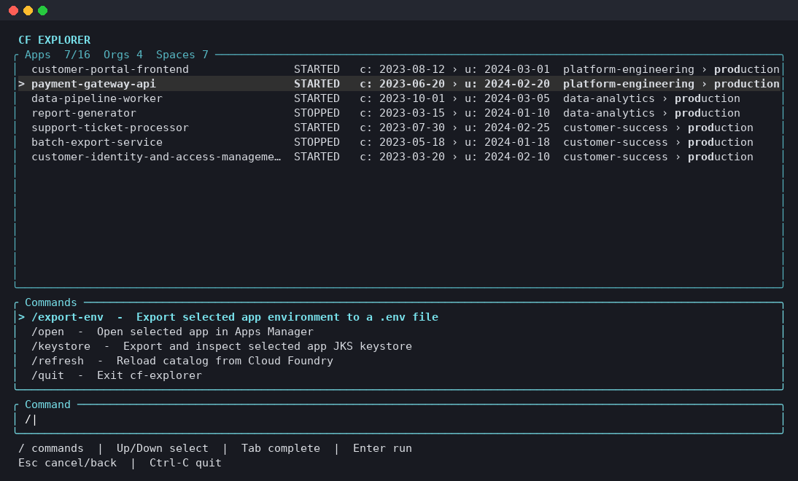
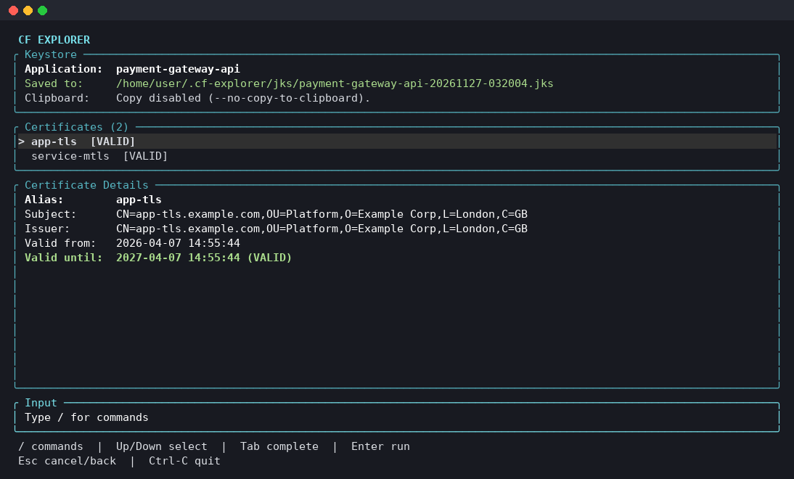

# cf-explorer

An interactive terminal browser for Cloud Foundry. Filter every application across
your organizations and spaces, start, stop, restart, or restage apps in the
background, interactively inspect and edit an app's environment variables, export an
app's environment to a `.env` file, decode and inspect its JKS keystore, or open it
in Apps Manager, all from one command-driven screen.



## Quick start

cf-explorer is distributed as a [JBang](https://www.jbang.dev/) script. JBang
downloads the dependencies (and a JDK, if needed) on first run; there is nothing to
build or install.

**Zero install, Linux and macOS:**

```bash
curl -Ls https://sh.jbang.dev | bash -s - run cf-explorer@garodriguezlp/cf-explorer
```

**Zero install, Windows PowerShell:**

```powershell
iex "& { $(iwr -useb https://ps.jbang.dev) } run cf-explorer@garodriguezlp/cf-explorer"
```

**With JBang installed:**

```bash
jbang cf-explorer@garodriguezlp/cf-explorer --env prod
```

**Install it as a command on your `PATH`:**

```bash
jbang app install cf-explorer@garodriguezlp/cf-explorer
cf-explorer --env prod
```

Run `jbang app install --force cf-explorer@garodriguezlp/cf-explorer` later to pick
up a new version.

**From a clone**, the bundled wrapper needs no JBang installation (use `jbang.cmd` on
Windows):

```bash
./jbang cf-explorer
```

Java 17 or newer is required; JBang provisions it automatically when none is found.
On the first remote run JBang asks whether to trust the source; trusting
`https://github.com/garodriguezlp/` covers future runs and updates.

## Try it without a foundation

The repository ships a WireMock server that simulates UAA and the Cloud Foundry v3
API with four organizations, seven spaces, and sixteen applications. The default
connection settings point at it.

```bash
# Terminal 1
jbang mock-server@garodriguezlp/cf-explorer     # or ./jbang mock-server

# Terminal 2
jbang cf-explorer@garodriguezlp/cf-explorer     # or ./jbang cf-explorer
```

The mock listens on `http://localhost:9090` and accepts `admin` / `admin`.

## Using the shell

The catalog loads when cf-explorer starts. Type to filter it; press `/` to run a
command against the selected app, or press its `Ctrl` shortcut from anywhere. The
command view lists each command's shortcut.

| Command | Shortcut | Available when | What it does |
|---|---|---|---|
| `/env` | `Ctrl+L` | An app is selected | Opens the interactive environment editor to fuzzy-search, add, update, or delete variables |
| `/export` | `Ctrl+E` | An app is selected | Writes the app's environment to `envs/<app>-<timestamp>.env` and copies the path to the clipboard |
| `/keystore` | `Ctrl+K` | An app is selected | Decodes the base64 JKS and password variables, writes `jks/<app>-<timestamp>.jks`, and lists each certificate's subject, issuer, and validity |
| `/open` | `Ctrl+O` | An app is selected | Opens the app in Apps Manager; prints the URL if no browser is available |
| `/start` | `Ctrl+U` | Selected app is not `STARTED` | Prompts for confirmation, starts the app in the background, and updates the catalog and cache |
| `/stop` | `Ctrl+P` | Selected app is not `STOPPED` | Prompts for confirmation, stops the app in the background, and updates the catalog and cache |
| `/restart` | `Ctrl+T` | An app is selected | Prompts for confirmation, restarts the app in the background, and updates the catalog and cache |
| `/restage` | `Ctrl+G` | An app is selected | Prompts for confirmation, stages a new build from the latest ready package, assigns the droplet, and restarts the app in the background |
| `/new` | `Ctrl+N` | Inside `/env` | Prompts for `KEY=VALUE` (or `Key` then `Value`), confirms, and stages a new variable |
| `/set` | `Enter` | Inside `/env` with a variable selected | Pre-fills the current value for in-place editing, confirms, and stages an update |
| `/delete` | | Inside `/env` with a variable selected | Confirms and stages deletion of the selected variable |
| `/undo` | | Inside `/env` on a staged variable | Reverts the staged change on the selected variable |
| `/apply` | `Ctrl+Y` | Inside `/env` with staged changes | Confirms all staged changes, patches Cloud Foundry atomically, and offers an inline `/restart` |
| `/refresh` | `Ctrl+R` | On the catalog | Reloads from Cloud Foundry, keeps the filter and selection, and updates the cache only on success |
| `/back` | `Ctrl+B` | On any opened page | Returns to the previous page (asks to confirm if `/env` has unapplied changes) |
| `/quit` | `Ctrl+X` | Always | Exits |

Shortcuts work while typing in the filter or the command view and leave the typed
text untouched. Every command name is a single word.

| Key | Action |
|---|---|
| Any text | Filters the catalog. Whitespace-separated tokens must all match the app name, state, org, space, GUID, or created/updated date (case-insensitive) |
| `Up` / `Down` | Moves the selection, or the highlighted suggestion while typing a command |
| `Left` / `Right`, `Home` / `End`, `Backspace` / `Delete` | Edit the filter or command |
| `/` | Starts a command without losing the filter |
| `Tab` | Completes the highlighted command |
| `Enter` | Runs the exact command, or the highlighted suggestion |
| `Esc` | Cancels the command, cancels a running load, returns from a page, or clears the filter |
| `Ctrl+C` | Quits immediately |

### Waiting and cancelling

Every wait shows an animation, so a slow foundation never looks like a hung
terminal:

- **Catalog loading** shows a checklist for sign-in, organizations, spaces, and apps
  (with `x of y` counts from the API), a progress gauge, and the elapsed time.
- **`/export` and `/keystore`** show an animated working page with the elapsed time,
  plus a reassurance line after 10 seconds.
- **`/start`, `/stop`, `/restart`, and `/restage`** ask for inline confirmation
  (`Enter`/`y` to confirm, `Esc`/`n` to cancel) showing the target organization,
  space, and profile, then run in the background so you can keep filtering and
  working. The app's row (`STARTING`, `STOPPING`, `RESTARTING`, `STAGING 1/4`…`4/4`)
  and the `Apps` panel header animate until completion, when a `✓` / `✗` status
  notification appears and the local cache updates.
- **`/refresh`** keeps the catalog usable. The title and status line show a spinner
  and progress until the new catalog arrives.
- **`/open`** shows a spinner in the status line until the browser launches.

Wait states stay up for at least 350 ms, so fast responses don't flicker. `Esc`
cancels any wait: the initial load (run `/refresh` to retry), a refresh (the current
catalog stays; if a filter is set, the first `Esc` clears it), or an export or
keystore page (returns to the catalog). Results that arrive after you cancel are
discarded.

Exported `.env` files contain every variable sorted by name, single-quoted and ready
to `source`. `TRUSTSTORE` is excluded and `SPRING_APPLICATION_JSON` is flattened to a
single line by default; see `--exclude-key` and `--post-process`.



## Configuration

Every option can be passed as a flag or an environment variable.

| Option | Environment variable | Default | Description |
|---|---|---|---|
| `--env` | | | Profile name (`[A-Za-z0-9_-]+`). Reads `CF_*_<ENV>` variables first and stores files under `~/.cf-explorer/<env>/` |
| `--cf-api-url` | `CF_API_URL[_<ENV>]` | `http://localhost:9090` | Cloud Foundry API URL |
| `--uaa-url` | `CF_UAA_URL[_<ENV>]` | `http://localhost:9090` | UAA URL |
| `--cf-username` | `CF_USERNAME[_<ENV>]` | `admin` | Username |
| `--cf-password` | `CF_PASSWORD[_<ENV>]` | `admin` | Password |
| `--cf-web-url` | `CF_WEB_URL[_<ENV>]` | `http://localhost:9090` | Apps Manager URL used by `/open` |
| `--[no-]skip-ssl-validation` | `CF_SKIP_SSL_VALIDATION[_<ENV>]` | `false` | Trust any TLS certificate and host name, for foundations with self-signed certificates |
| `--fresh` | | `false` | Ignore the local cache on startup |
| `--exclude-key` | | `TRUSTSTORE` | Variable to leave out of `.env` exports (exact match, repeatable) |
| `--post-process` | | `SPRING_APPLICATION_JSON=JSON` | `KEY=PROCESSOR` to apply to a variable on export (repeatable) |
| `--keystore-var` | `KEYSTORE_VAR` | `KEYSTORE` | Variable holding the base64-encoded JKS |
| `--keystore-password-var` | `KEYSTORE_PASSWORD_VAR` | `KEYSTORE_PASSWORD` | Variable holding the base64-encoded keystore password |
| `--[no-]copy-to-clipboard` | | `true` | Copy exported file paths to the clipboard |

### Profiles

Profiles let one machine target several foundations. With `--env prod`, each
connection option resolves in this order:

1. The command-line flag
2. `CF_*_PROD` as a Java system property, then as an environment variable
3. `~/.cf-explorer.properties`
4. `CF_*` as a Java system property, then as an environment variable
5. The built-in default

```bash
export CF_API_URL_PROD=https://api.sys.prod.example.com
export CF_UAA_URL_PROD=https://login.sys.prod.example.com
export CF_WEB_URL_PROD=https://apps.sys.prod.example.com
export CF_USERNAME_PROD=me@example.com
export CF_PASSWORD_PROD='...'
cf-explorer --env prod
```

### Properties file

Defaults for any option can be stored in `~/.cf-explorer.properties`, keyed by the
option name without leading dashes. Set the `picocli.defaults.cf-explorer.path`
system property to use a different file.

```properties
cf-api-url=https://api.sys.example.com
uaa-url=https://login.sys.example.com
cf-web-url=https://apps.sys.example.com
```

### Local files

Everything cf-explorer writes lives under `~/.cf-explorer/`, or
`~/.cf-explorer/<env>/` with `--env`:

| Path | Contents |
|---|---|
| `cache/` | `organizations.json`, `spaces.json`, `apps.json`, used for instant startup |
| `envs/` | Exported `<app>-<yyyyMMdd-HHmmss>.env` files |
| `jks/` | Exported `<app>-<yyyyMMdd-HHmmss>.jks` files |
| `cf-explorer.log` | Warnings and failures (class names only; no secrets or response bodies) |

## Upgrading from the previous version

The catalog, cache format, profiles, and `.env` format are unchanged. Behavior that
changed:

- **Slash commands replace key bindings.** `Enter`, `Ctrl+O`, `Ctrl+K`, `Ctrl+F`, and
  `q` became `/export`, `/open`, `/keystore`, `/refresh`, and `/quit`, so every
  printable key, including `q`, now edits the filter. `Ctrl` shortcuts are back for
  every command (see [Using the shell](#using-the-shell)); `Ctrl+F` is now `Ctrl+R`
  (`/refresh`).
- **`/export-env` is now `/export`.** Every command is a single word, and the old
  name has no alias.
- **TLS is verified by default.** The previous version trusted every certificate. Pass
  `--skip-ssl-validation` (or set `CF_SKIP_SSL_VALIDATION_<ENV>=true`) for
  foundations with self-signed certificates.
- **Keystore file names no longer contain the password.** Files are written as
  `<app>-<timestamp>.jks` instead of `<app>-pass_<password>-<timestamp>.jks`.
- **Refresh is non-destructive.** A failed `/refresh` keeps the current catalog on
  screen and the cache on disk.
- **The filter matches more fields**, including GUIDs and dates, and highlights the
  matches.
- **Clipboard failures are reported separately**, so a successful export is never
  shown as an error.

## Development

The same sources build with Maven and run with JBang. `CfExplorer.java` declares the
JBang dependencies (`//DEPS`) and every other source file (`//SOURCES`); the build
fails if they drift from `pom.xml` or the source tree.

```bash
mvn verify                 # unit, WireMock, alignment, and launch tests
java -jar target/cf-explorer.jar
mvn -q compile exec:java
./jbang src/main/java/cf/explorer/CfExplorer.java
```

`mvn verify` also starts the TUI through the jar, `exec:java`, the script, the local
catalog alias, and a catalog served over HTTP with an empty JBang cache, so the
published `cf-explorer@garodriguezlp/cf-explorer` path is covered before it ships.

### Source layout

| Package | Responsibility |
|---|---|
| `cf.explorer` | Entry point and CLI (`CfExplorer`), wiring (`ExplorerScreen`), and commands (`ExplorerCommands`) |
| `cf.explorer.config` | Resolved configuration and export post-processors |
| `cf.explorer.catalog` | Catalog model, UAA and CF v3 client, profile cache |
| `cf.explorer.env` | Environment variable draft staging, fuzzy search, and `PATCH` service |
| `cf.explorer.export` | `.env` formatting and export |
| `cf.explorer.keystore` | JKS decoding, file writing, and certificate inspection |
| `cf.explorer.lifecycle` | App `start`, `stop`, `restart`, and multi-step `restage` orchestration |
| `cf.explorer.browser` | Apps Manager URLs and browser launch |
| `cf.explorer.io` | Clipboard and log setup |
| `cf.explorer.model` | UI-independent shell state, commands, and page contract |
| `cf.explorer.ui` | [TamboUI](https://tamboui.dev) pages and the shell layout |

Network, file, clipboard, and browser work runs on a background worker; results are
applied on the render thread and discarded if you have already navigated away.

See [AGENTS.md](AGENTS.md) for contribution conventions.

Built with [TamboUI](https://tamboui.dev), [picocli](https://picocli.info),
[Jackson](https://github.com/FasterXML/jackson), and [JBang](https://www.jbang.dev/).
